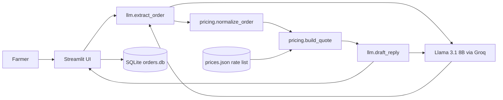
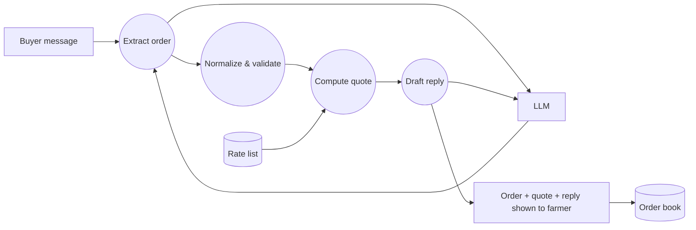
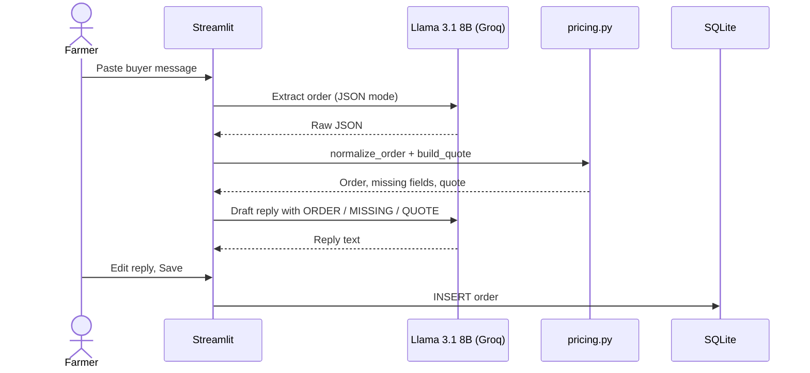
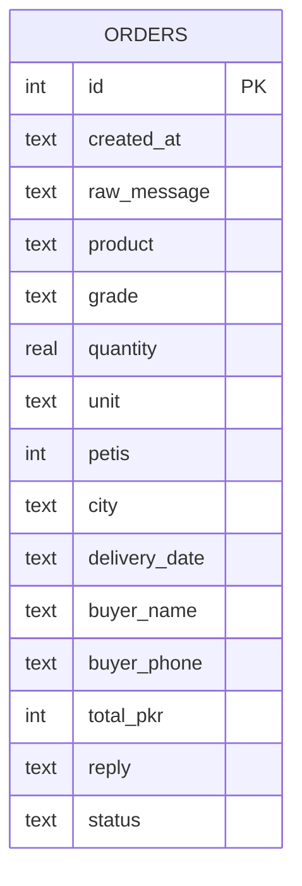

# 🍊 Mandi Desk

**AI order desk for small fruit farmers who sell direct, without middlemen.**
Paste a buyer's WhatsApp message (Roman Urdu, Urdu or English) and Mandi Desk extracts the order, prices it from the farmer's own rate list, drafts a reply in the buyer's language, and saves it to an order book.

Built at Hacktoberfest Lahore 2026 (Riphah International University).

## Problem
Farmers selling directly (e.g. Kinnow growers in Sargodha) receive inquiries as messy chat messages:
*"bhai 50 peti kinnow chahiye A grade, Lahore delivery agle hafte, rate?"*
Tracking these by hand leads to missed orders, inconsistent quotes and slow replies, which pushes farmers back to middlemen.

**Target user:** a small/medium farmer or farm manager handling buyer inquiries on WhatsApp.

## Solution & core features
1. **Order extraction:** an open-weight LLM turns a free-text message into structured JSON (product, grade, quantity, unit, city, delivery date, buyer name/phone) and flags missing fields.
2. **Deterministic pricing:** Python (not the LLM) converts units (peti / kg / maund / ton) and computes rate, delivery and total, so prices are never hallucinated.
3. **Reply drafting:** the LLM writes a short WhatsApp reply in the buyer's own language and script, using only the computed numbers, and asks for missing details.
4. **Order book:** orders are saved in SQLite with a status (new → quoted → confirmed → delivered / cancelled).
5. **Editable rate list** in the sidebar.

## AI component
| Item | Value |
|---|---|
| Model | `llama-3.1-8b-instant` (Meta Llama 3.1 8B Instruct) |
| Parameter size | 8B |
| Provider / runtime | Groq API (OpenAI-compatible). Alternative: Ollama locally, e.g. `qwen3:8b` |
| Calls per message | 2: (1) extraction with JSON mode, temperature 0; (2) reply drafting, temperature 0.3 |
| What it does | Multilingual understanding of Roman Urdu / Urdu / English buyer messages and generation of the reply. Without the model the app cannot read orders at all. |

## Architecture


## Data flow


## Sequence


## ER diagram


## Setup
Requires Python 3.9+.
```bash
git clone https://github.com/<your-username>/mandi-desk.git
cd mandi-desk
python -m venv .venv && source .venv/bin/activate   # Windows: .venv\Scripts\activate
pip install -r requirements.txt
cp .env.example .env   # then put your key in GROQ_API_KEY
```
Environment variables: `GROQ_API_KEY` (or `LLM_API_KEY`), `MODEL_NAME`, optional `LLM_BASE_URL`.

**Using Ollama instead:** `ollama pull qwen3:8b`, then in `.env` set `LLM_BASE_URL=http://localhost:11434/v1`, `LLM_API_KEY=ollama`, `MODEL_NAME=qwen3:8b`.

## Run
```bash
streamlit run app.py
```
Minimal example: pick the first sample message, click **Process message**. Expected: kinnow, grade A, 50 peti, Lahore → 50 × 2,200 + 800 delivery = **110,800 PKR**, and a Roman Urdu reply.

## Testing
```bash
pytest -q          # pricing/normalisation unit tests (no API key needed)
python run_eval.py # runs 8 real buyer messages through the model, writes eval_results.md
```

### Findings
<!-- Paste the table from eval_results.md here after running run_eval.py -->
| # | Input | Expected | Result | Notes |
|---|---|---|---|---|
| | | | | |

## Known limitations
- Prices are per peti; delivery is a flat fee per city from `prices.json`.
- Only products in the rate list are recognised (kinnow, mosambi by default).
- An 8B model can misread unusual spellings or mixed-script messages; the farmer reviews every reply before sending (human in the loop).
- No direct WhatsApp integration yet; messages are pasted manually.
- Single-user, local SQLite database.

## Team
| Name | Contribution |
|---|---|
| Hammad | Idea, prompts, pricing logic, UI, testing |

## Acknowledgements
- Meta Llama 3.1 (Llama 3.1 Community License), served via Groq
- Streamlit, OpenAI Python SDK (used as an OpenAI-compatible client), python-dotenv, pytest
- AI-assisted development: code drafted with help from Claude and reviewed/tested by the team

## License
MIT. See [LICENSE](LICENSE).
