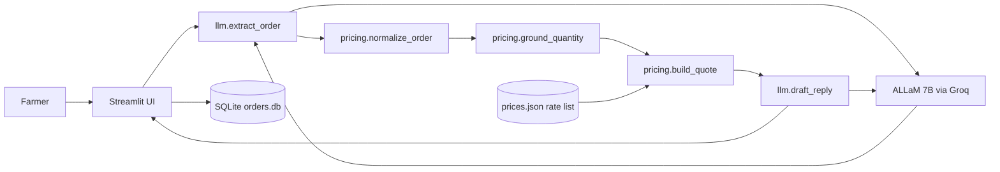
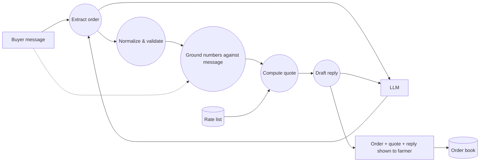
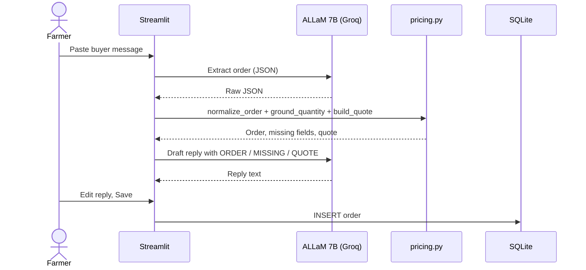
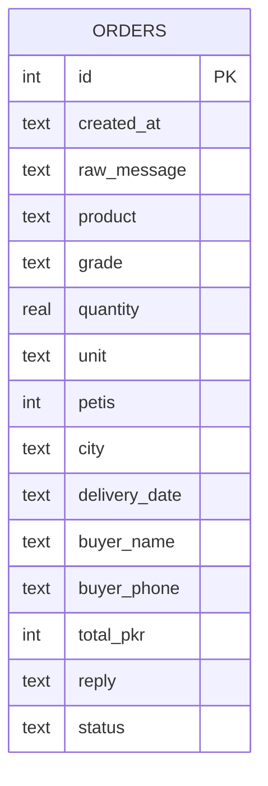

# 🍊 Mandi Desk

**AI order desk for small fruit farmers who sell direct, without middlemen.**
Paste a buyer's WhatsApp message (Roman Urdu, Urdu or English) and Mandi Desk extracts the order, prices it from the farmer's own rate list, drafts a reply in the buyer's language, and saves it to an order book.

> **Open-weight AI:** Mandi Desk is powered by **ALLaM 7B Instruct**, an **open-weight** model (7B parameters, Apache-2.0) served through the Groq API. The model is central to the product: it reads every buyer message and writes every reply.

Built at Hacktoberfest Lahore 2026 (Riphah International University).

**How it is used:** Mandi Desk is the farmer's private back-office tool and runs locally on the farmer's computer. Buyers keep messaging on WhatsApp as usual; the farmer pastes their messages into Mandi Desk, reviews the drafted reply and sends it back.

## Problem
Farmers selling directly (e.g. Kinnow growers in Sargodha) receive inquiries as messy chat messages:
*"bhai 50 peti kinnow chahiye A grade, Lahore delivery agle hafte, rate?"*
Tracking these by hand leads to missed orders, inconsistent quotes and slow replies, which pushes farmers back to middlemen.

**Target user:** a small/medium farmer or farm manager handling buyer inquiries on WhatsApp.

## Solution & core features
1. **Order extraction:** an open-weight LLM turns a free-text message into structured JSON (product, grade, quantity, unit, city, delivery date, buyer name/phone) and flags missing fields.
2. **Deterministic pricing with number grounding:** quantities are checked against the original message, then Python (not the LLM) converts units (peti / kg / maund / ton) and computes rate, delivery and total, so prices are never hallucinated.
3. **Reply drafting:** the LLM writes a short WhatsApp reply in the buyer's own language and script, using only the computed numbers, and asks for missing details.
4. **Order book:** orders are saved in SQLite with a status (new → quoted → confirmed → delivered / cancelled).
5. **Editable rate list** in the sidebar.

## AI component
| Item | Value |
|---|---|
| Model | `allam-2-7b` on Groq: ALLaM 7B Instruct by SDAIA, open-weight (published on Hugging Face as `ALLaM-AI/ALLaM-7B-Instruct-preview`) |
| Parameter size | 7B (within the event's 8B limit) |
| Open-weight | Yes. Weights are publicly released on Hugging Face under the **Apache-2.0** license ([model card](https://huggingface.co/ALLaM-AI/ALLaM-7B-Instruct-preview)) |
| Provider / runtime | Groq API (OpenAI-compatible). Alternative: Ollama locally, e.g. `qwen3:8b` |
| Why this model | It was the only chat model of 8B or fewer parameters available on our Groq account at build time (`llama-3.1-8b-instant` returned 404). |
| Integration | `llm.py` calls the model through the OpenAI-compatible Chat Completions API (`openai` Python SDK with Groq's base URL). Model name, key and base URL come from environment variables, so the same code runs against Ollama. |
| Calls per message | 2: (1) extraction to JSON, temperature 0 (JSON mode when supported, otherwise defensive JSON parsing); (2) reply drafting, temperature 0.3 |
| What it does | Multilingual understanding of Roman Urdu / Urdu / English buyer messages and generation of the reply. Without the model the app cannot read orders at all. |

## Architecture


## Data flow


## Sequence


## ER diagram


## Setup
Requires Python 3.9+.
```bash
git clone https://github.com/hellohammadi/mandi-desk.git
cd mandi-desk
python3 -m venv .venv && source .venv/bin/activate   # Windows: python -m venv .venv && .venv\Scripts\activate
pip install -r requirements.txt
cp .env.example .env   # then put your Groq API key in GROQ_API_KEY (never commit .env)
```
Environment variables: `GROQ_API_KEY` (or `LLM_API_KEY`), `MODEL_NAME`, optional `LLM_BASE_URL`.

**Using Ollama instead:** `ollama pull qwen3:8b`, then in `.env` set `LLM_BASE_URL=http://localhost:11434/v1`, `LLM_API_KEY=ollama`, `MODEL_NAME=qwen3:8b`.

## Run
```bash
streamlit run app.py
```
Opens at http://localhost:8501.

Minimal example: pick the first sample message, click **Process message**. Expected: kinnow, grade A, 50 peti, Lahore → 50 × 2,200 + 800 delivery = **110,800 PKR**, and a Roman Urdu reply.

More examples to type in (default rate list in `prices.json`):

| Buyer message | Expected result |
|---|---|
| `Need 3 tons of A grade kinnow for export, Karachi port, 1st December. Bilal 0321-5556677` | 300 peti × 2,200 + 3,000 = **663,000 PKR**, English reply |
| `20 mann mosambi B grade chahiye Faisalabad` | 80 peti × 1,600 + 1,500 (default delivery) = **129,500 PKR** |
| `bhai 15 peti kinno chahiye Multan bhejna hai` | No quote: grade is missing, so the reply asks for it |

## Testing
```bash
pytest -q          # pricing/normalisation unit tests (no API key needed)
python run_eval.py # runs 8 real buyer messages through the model, writes eval_results.md
```

### Findings
Eval set: 8 real-style buyer messages (`samples.json`) covering Roman Urdu, Urdu script, English, unit variety (peti, mann/maund, kg, ton, crates), a price-only inquiry and a non-order message. A sample passes only if every expected field matches.

**Run 1, `allam-2-7b`, initial prompt: 6/8 passed**

| # | Input | Result | Notes |
|---|---|---|---|
| 1 | AoA bhai 50 peti kinnow chahiye A grade, Lahore delivery agl... | PASS | - |
| 2 | Salam, 20 mann kinno B grade ka rate kya hai? Islamabad bhej... | FAIL | product: expected kinnow, got None |
| 3 | Hi, I need 500 kg of grade A kinnow delivered to Karachi by ... | PASS | - |
| 4 | السلام علیکم، مجھے 30 پیٹی کینو چاہیے، اے گریڈ، لاہور میں اگ... | PASS | - |
| 5 | bhai kinnow ka rate bata do | PASS | - |
| 6 | 100 crates mosambi C grade chahiye Sargodha pickup kal | PASS | - |
| 7 | Mujhe 2 ton kinnow chahiye wholesale ke liye, grade B, Lahor... | FAIL | quantity: expected 2, got 2000.0 |
| 8 | kal wala order cancel kar do please | PASS | - |

Observed issues and fixes:
- **#2:** the model's product string did not exactly match a known alias, so validation rejected it. Fix: product matching now also checks each word of the model's answer against the alias list, and the prompt asks for a single canonical word.
- **#7:** the model converted 2 ton into 2000 itself while also reporting the unit as ton. Fix: the prompt now says to copy the number as written and never convert units, since conversion is done deterministically in `pricing.py`.

**Run 2, after the two fixes: 7/8 passed.** #2 now passes. #7 still failed (quantity 2000 instead of 2): the model kept converting tons to kg despite the prompt instruction.

Fix 2: a deterministic **number-grounding check** (`pricing.ground_quantity`). If the model's quantity does not appear anywhere in the buyer's message, but the quantity divided by the unit factor (1000 for ton, 40 for maund) does, the original number is restored. The model's numbers are never trusted blindly.

**Run 3, after the grounding check: 8/8 passed.** Expected output = the fields in `samples.json`; actual output = what the pipeline returned (identical for every sample in this run).

| # | Scenario | Input | Expected output (product, grade, qty, unit, city) | Actual outcome | Result |
|---|---|---|---|---|---|
| 1 | Roman Urdu full order | AoA bhai 50 peti kinnow chahiye A grade, Lahore delivery agle hafte. Ahmed 0300-1234567 | kinnow, A, 50, peti, Lahore | same | PASS |
| 2 | Roman Urdu, mann unit, spelling variant | Salam, 20 mann kinno B grade ka rate kya hai? Islamabad bhejna hai Friday tak | kinnow, B, 20, maund, Islamabad | same | PASS |
| 3 | English, kg unit | Hi, I need 500 kg of grade A kinnow delivered to Karachi by 25 November. - Sara | kinnow, A, 500, kg, Karachi | same | PASS |
| 4 | Urdu script | السلام علیکم، مجھے 30 پیٹی کینو چاہیے، اے گریڈ، لاہور میں اگلے ہفتے | kinnow, A, 30, peti, Lahore | same | PASS |
| 5 | Price inquiry only | bhai kinnow ka rate bata do | kinnow, null, null, null, null | same | PASS |
| 6 | Other product, crates | 100 crates mosambi C grade chahiye Sargodha pickup kal | mosambi, C, 100, peti, Sargodha | same | PASS |
| 7 | Ton unit (model tends to convert) | Mujhe 2 ton kinnow chahiye wholesale ke liye, grade B, Lahore, next month | kinnow, B, 2, ton, Lahore | same (2000 corrected to 2 by grounding check) | PASS |
| 8 | Not an order | kal wala order cancel kar do please | all null | same | PASS |

Unit tests (`pytest -q`): 8 tests for normalisation, product matching, unit conversion, quoting and number grounding, all passing.

| Run | Change | Passed |
|---|---|---|
| 1 | Initial prompt | 6/8 |
| 2 | Product word matching + "don't convert units" prompt | 7/8 |
| 3 | Deterministic number-grounding check | 8/8 |

Note: 8 samples is a small set and was also used while fixing, so this shows the pipeline works on these cases, not general accuracy. The eval checks extraction only; reply drafts were checked manually in the app.

## Known limitations
- Prices are per peti; delivery is a flat fee per city from `prices.json`.
- Only products in the rate list are recognised (kinnow, mosambi by default).
- The 7B model can misread unusual spellings or mixed-script messages; the farmer reviews every reply before sending (human in the loop).
- No direct WhatsApp integration yet; messages are pasted manually.
- Single-user, local SQLite database; runs locally and is not deployed publicly (it holds buyer names, phone numbers and the farmer's rates).
- The grounding check only handles a model that multiplies by the unit factor (ton, maund); other numeric mistakes are caught only by the farmer's review.

## Team
| Name | Contribution |
|---|---|
| Hammad | Problem and domain knowledge (Kinnow grower, Sargodha), product decisions, model selection, running the evaluation and the fix iterations, demo |

## Acknowledgements
- ALLaM 7B Instruct by SDAIA, Apache-2.0 ([model card](https://huggingface.co/ALLaM-AI/ALLaM-7B-Instruct-preview)), served via Groq
- Streamlit, OpenAI Python SDK (used as an OpenAI-compatible client), python-dotenv, pytest
- AI-assisted development: code and documentation were drafted with help from Claude (Anthropic) and run, tested and iterated on by the team

## License
MIT. See [LICENSE](LICENSE).
